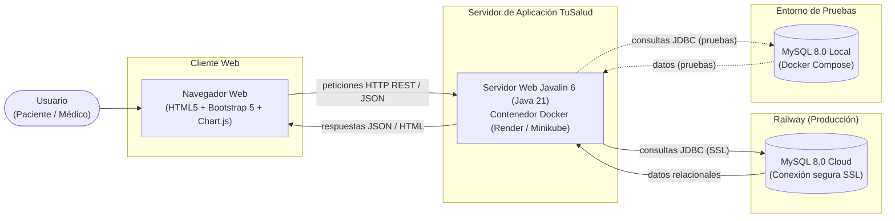
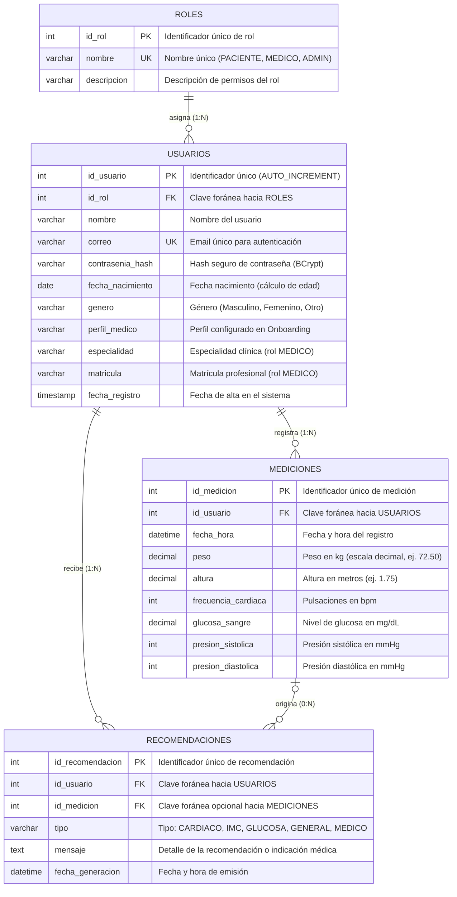

# Diagrama de infraestructura

El sistema implementa una arquitectura cliente-servidor web desacoplada. Los usuarios acceden desde cualquier dispositivo mediante un navegador web estándar. El servidor Javalin empaquetado en Docker gestiona las rutas REST, ejecuta las reglas de negocio clínicas y se comunica de forma cifrada mediante JDBC con el servidor de base de datos MySQL 8.0 alojado en Railway (o en un contenedor local para el entorno de desarrollo y pruebas).

---

# Modelo Relacional

El modelo relacional está diseñado en **Tercera Forma Normal (3NF)** para garantizar la integridad referencial, eliminar redundancias y escalar eficientemente en **MySQL**.

### Diagrama Entidad-Relación

---

### Especificación de Tablas y Esquema Relacional

#### 1. Notación Relacional Formal
* **`ROLES`** (**`id_rol`** [PK], `nombre` [UK], `descripcion`)
* **`USUARIOS`** (**`id_usuario`** [PK], `id_rol` [FK], `nombre`, `correo` [UK], `contrasenia_hash`, `fecha_nacimiento`, `genero`, `perfil_medico`, `especialidad`, `matricula`, `fecha_registro`)
* **`MEDICIONES`** (**`id_medicion`** [PK], `id_usuario` [FK], `fecha_hora`, `peso`, `altura`, `frecuencia_cardiaca`, `glucosa_sangre`, `presion_sistolica`, `presion_diastolica`)
* **`RECOMENDACIONES`** (**`id_recomendacion`** [PK], `id_usuario` [FK], `id_medicion` [FK], `tipo`, `mensaje`, `fecha_generacion`)

#### 2. Relaciones e Integridad Referencial
1. **ROLES — USUARIOS (1 : N)**
   * Un rol puede estar asignado a múltiples usuarios del sistema.
   * Cada usuario posee exactamente un rol asignado (`id_rol NOT NULL`).
   * Clave Foránea: `USUARIOS.id_rol` $\rightarrow$ `ROLES.id_rol` (`ON DELETE RESTRICT`, `ON UPDATE CASCADE`), impidiendo eliminar roles que tengan usuarios asociados.

2. **USUARIOS — MEDICIONES (1 : N)**
   * Un usuario puede registrar $0$ a muchas mediciones a lo largo del tiempo.
   * Cada medición pertenece estrictamente a un único usuario (`id_usuario NOT NULL`).
   * Clave Foránea: `MEDICIONES.id_usuario` $\rightarrow$ `USUARIOS.id_usuario` (`ON DELETE CASCADE`, `ON UPDATE CASCADE`).

3. **USUARIOS — RECOMENDACIONES (1 : N)**
   * Un usuario recibe múltiples recomendaciones (generadas automáticamente o emitidas por médicos).
   * Clave Foránea: `RECOMENDACIONES.id_usuario` $\rightarrow$ `USUARIOS.id_usuario` (`ON DELETE CASCADE`, `ON UPDATE CASCADE`).

4. **MEDICIONES — RECOMENDACIONES (0 : N)**
   * Una medición específica puede disparar o asociarse a una recomendación (relación opcional).
   * Clave Foránea: `RECOMENDACIONES.id_medicion` $\rightarrow$ `MEDICIONES.id_medicion` (`ON DELETE SET NULL`, `ON UPDATE CASCADE`).

#### 3. Criterios de Diseño y Buenas Prácticas Técnicas
* **Seguridad de Credenciales**: No se almacena la contraseña en texto plano; se define `contrasenia_hash` con capacidad para almacenar hashes seguros generados mediante BCrypt con salt.
* **Control de Acceso Basado en Roles (RBAC)**: La inclusión de la tabla `ROLES` permite desacoplar la autenticación de la autorización, separando los permisos entre pacientes clínicos y médicos administradores.
* **Campos Atómicos y Flexibilidad Biométrica**: Los campos biométricos (`peso`, `altura`, `frecuencia_cardiaca`, `glucosa_sangre`, presiones) son opcionales (`NULLABLE`), respetando el requerimiento donde el usuario no necesita cargar todos los valores en cada toma.
* **Regla de Negocio / Restricción**: Se añade una restricción de validación (`chk_al_menos_un_dato`) para asegurar que al menos un dato biométrico válido sea provisto al insertar una medición.
* **Parametrización por Perfil Médico**: El atributo `perfil_medico` en `USUARIOS` persiste la condición clínica obtenida en el cuestionario inicial, permitiendo restringir y validar la captura biométrica tanto en el frontend como en la capa de servicios Java.
* **Cálculo Derivado**: La edad no se almacena para evitar inconsistencias cronológicas; se calcula en tiempo de ejecución a partir de `fecha_nacimiento`.
* **Soporte a Transacciones ACID**: El diseño garantiza operaciones multi-tabla consistentes (por ejemplo, registrar una medición y sus recomendaciones asociadas en una transacción con `commit` y `rollback`).
