# Diagrama de clases

```mermaid
classDiagram
    class Usuario {
        -int idUsuario
        -int idRol
        -String rolNombre
        -String nombre
        -String correo
        -String contraseniaHash
        -Date fechaNacimiento
        -String genero
        -String perfilMedico
        +getDescripcionRol() String
        +tieneAccesoPanelMedico() boolean
    }

    class Paciente {
        -List~Medicion~ mediciones
        -List~Recomendacion~ recomendaciones
        +getDescripcionRol() String
        +tieneAccesoPanelMedico() boolean
    }

    class Medico {
        -String especialidad
        -String matricula
        +getDescripcionRol() String
        +tieneAccesoPanelMedico() boolean
    }

    class Medicion {
        -int idMedicion
        -int idUsuario
        -Date fecha
        -double altura
        -double peso
        -int frecuenciaCardiaca
        -double glucosaSangre
        -Integer presionSistolica
        -Integer presionDiastolica
    }

    class Recomendacion {
        -int idRecomendacion
        -int idUsuario
        -Integer idMedicion
        -String mensaje
        -String tipo
        -Date fechaGeneracion
    }

    class Promedio {
        <<interface>>
        +calcularCardiaco(List~Medicion~ mediciones) double
        +calcularGlucosa(List~Medicion~ mediciones) double
        +calcularIMC(List~Medicion~ mediciones) double
    }

    class AnalisisService {
        +calcularCardiaco(List~Medicion~ mediciones) double
        +calcularGlucosa(List~Medicion~ mediciones) double
        +calcularIMC(List~Medicion~ mediciones) double
        +validarMedicion(Medicion medicion) void
        +generarRecomendaciones(List~Medicion~ mediciones) List~Recomendacion~
        +generarGraficaEvolucion(List~Medicion~ mediciones)
        +generarGraficaFiltrada(List~Medicion~ mediciones)
        +compararMediciones(Medicion medicion1, Medicion medicion2)
    }

    class PerfilMedicoService {
        +puedeEditarPeso(String perfil) boolean
        +puedeEditarAltura(String perfil) boolean
        +puedeEditarFrecuencia(String perfil) boolean
        +puedeEditarGlucosa(String perfil) boolean
        +sanitizarMedicion(Medicion medicion, String perfil) void
        +getNombreLegible(String perfil) String
    }

    class ComparacionBiometrica {
        -double diferenciaPeso
        -double diferenciaIMC
        -double diferenciaCardiaca
        -double diferenciaGlucosa
    }

    class TuSaludException {
        +TuSaludException(String mensaje)
    }

    class IUsuarioDAO {
        <<interface>>
        +registrar(Usuario usuario, String contraseniaPlana) boolean
        +iniciarSesion(String correo, String contraseniaPlana) Usuario
        +obtenerPorId(int idUsuario) Usuario
        +actualizarPerfilMedico(int idUsuario, String perfil) boolean
        +actualizarDatosUsuario(Usuario usuario) boolean
        +eliminar(int idUsuario) boolean
        +buscarPacientes(String filtro) List~Usuario~
        +obtenerHistoriaClinicaConsolidada(int idUsuario) Map~String, Object~
        +obtenerReporteGlobalPorPerfil() List~Map~
    }

    class UsuarioDAO {
        +registrar(Usuario usuario, String contraseniaPlana) boolean
        +iniciarSesion(String correo, String contraseniaPlana) Usuario
        +obtenerPorId(int idUsuario) Usuario
        +actualizarPerfilMedico(int idUsuario, String perfil) boolean
        +buscarPacientes(String filtro) List~Usuario~
        +obtenerHistoriaClinicaConsolidada(int idUsuario) Map~String, Object~
        +obtenerReporteGlobalPorPerfil() List~Map~
    }

    class IMedicionDAO {
        <<interface>>
        +agregar(Medicion m) boolean
        +registrarConRecomendaciones(Medicion m, List~Recomendacion~ r) boolean
        +obtenerPorUsuario(int idUsuario) List~Medicion~
        +actualizar(Medicion m) boolean
        +eliminar(int idMedicion, int idUsuario) boolean
        +obtenerEvolucionMensualGlobal() List~Map~
    }

    class MedicionDAO {
        +agregar(Medicion m) boolean
        +registrarConRecomendaciones(Medicion m, List~Recomendacion~ r) boolean
        +obtenerPorUsuario(int idUsuario) List~Medicion~
        +actualizar(Medicion m) boolean
        +eliminar(int idMedicion, int idUsuario) boolean
        +obtenerEvolucionMensualGlobal() List~Map~
    }

    class IRecomendacionDAO {
        <<interface>>
        +guardar(Recomendacion r) boolean
        +obtenerPorUsuario(int idUsuario) List~Recomendacion~
        +actualizar(Recomendacion r) boolean
        +eliminar(int idRecomendacion, int idUsuario) boolean
        +eliminarPorMedico(int idRecomendacion) boolean
    }

    class RecomendacionDAO {
        +guardar(Recomendacion r) boolean
        +obtenerPorUsuario(int idUsuario) List~Recomendacion~
        +actualizar(Recomendacion r) boolean
        +eliminar(int idRecomendacion, int idUsuario) boolean
        +eliminarPorMedico(int idRecomendacion) boolean
    }

    Usuario <|-- Paciente : hereda
    Usuario <|-- Medico : hereda

    Usuario "1" --> "*" Medicion : registra
    Usuario "1" --> "*" Recomendacion : recibe

    UsuarioDAO ..|> IUsuarioDAO : implementa
    MedicionDAO ..|> IMedicionDAO : implementa
    RecomendacionDAO ..|> IRecomendacionDAO : implementa

    UsuarioDAO ..> Usuario : gestiona
    MedicionDAO ..> Medicion : gestiona
    RecomendacionDAO ..> Recomendacion : gestiona

    AnalisisService ..|> Promedio : implementa
    AnalisisService ..> Medicion : analiza
    AnalisisService ..> Recomendacion : genera
    AnalisisService ..> ComparacionBiometrica : genera
    AnalisisService ..> TuSaludException : lanza

    PerfilMedicoService ..> Usuario : valida perfil de
    PerfilMedicoService ..> Medicion : filtra y sanitiza
```

---

## Casos de Uso

### Actores

* **Usuario / Paciente:** utiliza la aplicación para registrar, consultar y analizar sus mediciones biométricas personales, configurar su perfil de seguimiento médico y recibir recomendaciones.
* **Médico / Administrador:** profesional de la salud o administrador que accede al panel médico para buscar pacientes, auditar historias clínicas consolidadas, prescribir recomendaciones médicas directas y evaluar estadísticas globales.
* **Sistema / Monitor:** proceso automatizado que monitorea la salud del servicio y la conectividad de la base de datos vía HTTP.

---

### CU01 - Registrarse

**Actor:** Usuario

**Objetivo:** Crear una cuenta en el sistema.

#### Flujo principal
1. El usuario selecciona la opción de registrarse.
2. El sistema solicita los datos necesarios (nombre, correo electrónico, contraseña, fecha de nacimiento, género).
3. El usuario introduce sus datos.
4. El sistema valida la información (verificando que el correo no esté duplicado y aplicando hash BCrypt a la contraseña).
5. El sistema crea la cuenta asignando el rol `PACIENTE` por defecto.
6. El sistema confirma el registro exitoso.

#### Flujo alternativo
* Si los datos introducidos no son válidos o el correo ya existe, el sistema informa al usuario y solicita corregirlos.

---

### CU02 - Iniciar sesión

**Actor:** Usuario

**Objetivo:** Acceder a su cuenta.

#### Flujo principal
1. El usuario introduce sus credenciales (correo y contraseña).
2. El sistema verifica las credenciales contrastando el hash con BCrypt.
3. El sistema identifica el rol (`PACIENTE` o `MEDICO`) y redirige al panel correspondiente.

#### Flujo alternativo
* Si las credenciales son incorrectas, el sistema informa al usuario y solicita introducirlas nuevamente.

---

### CU03 - Registrar datos biométricos

**Actor:** Usuario

**Objetivo:** Guardar nuevas mediciones biométricas.

#### Flujo principal
1. El usuario selecciona la opción para registrar una medición.
2. El sistema consulta el perfil médico del usuario y habilita únicamente los campos relevantes (bloqueando métricas no contempladas).
3. El usuario introduce sus mediciones en los campos habilitados.
4. El sistema valida y sanitiza los datos según el perfil activo (comprobando rangos biológicos mediante `AnalisisService`).
5. El sistema guarda las mediciones junto con la fecha y hora.
6. El sistema confirma el registro.

#### Regla de Negocio (Restricción por Perfil)
* Los campos de entrada se ajustan a la condición seleccionada en el Cuestionario Inicial (p. ej., control exclusivo de Diabetes habilita solo Glucosa; control de Hipertensión habilita Frecuencia Cardíaca).
* Los campos bloqueados permanecen deshabilitados con mensaje explicativo y no se persisten en la base de datos.

#### Datos que se pueden registrar
* Peso.
* Altura.
* Frecuencia cardíaca.
* Glucosa en sangre.

---

### CU04 - Actualizar datos biométricos

**Actor:** Usuario

**Objetivo:** Modificar una medición registrada anteriormente.

#### Flujo principal
1. El usuario selecciona un registro anterior.
2. El sistema muestra los datos registrados, bloqueando los campos que no correspondan a su perfil médico actual.
3. El usuario modifica la información permitida.
4. El sistema valida y sanitiza los nuevos datos.
5. El sistema guarda los cambios.
6. El sistema confirma la actualización.

#### Flujo alternativo
* Si los nuevos datos no son válidos, el sistema informa al usuario y solicita corregirlos.

#### Regla de Negocio
* Al editar, solo se permite alterar las métricas autorizadas por el perfil médico vigente del usuario; los demás valores se conservan o visualizan como solo lectura.

---

### CU05 - Consultar historial

**Actor:** Usuario

**Objetivo:** Consultar las mediciones realizadas anteriormente.

#### Flujo principal
1. El usuario selecciona la opción de historial.
2. El sistema obtiene los registros pertenecientes exclusivamente al usuario autenticado.
3. El sistema muestra las mediciones ordenadas cronológicamente.
4. El usuario puede consultar, filtrar o seleccionar registros para su edición o eliminación.

---

### CU06 - Calcular promedios

**Actor:** Usuario

**Objetivo:** Obtener el promedio de sus mediciones.

#### Flujo principal
1. El usuario selecciona el tipo de medición que desea analizar (Frecuencia cardíaca, Glucosa o IMC).
2. El sistema obtiene los registros históricos correspondientes.
3. El sistema calcula la media aritmética a través de `AnalisisService` (implementación de `Promedio`).
4. El sistema muestra el resultado estadístico.

---

### CU07 - Visualizar gráficos

**Actor:** Usuario

**Objetivo:** Observar visualmente la evolución de sus mediciones.

#### Flujo principal
1. El usuario selecciona el tipo de dato que desea consultar en el dashboard.
2. El sistema obtiene los registros históricos del paciente.
3. El sistema genera y renderiza un gráfico interactivo cronológico (Chart.js).
4. El usuario puede alternar variables y observar tendencias temporales.

---

### CU08 - Comparar mediciones

**Actor:** Usuario

**Objetivo:** Comparar mediciones realizadas en diferentes fechas.

#### Flujo principal
1. El usuario selecciona dos fechas del historial que desea comparar.
2. El sistema obtiene los datos correspondientes a ambas mediciones.
3. El sistema calcula las diferencias numéricas y porcentuales (`ComparacionBiometrica`).
4. El sistema muestra visualmente las diferencias entre ambas mediciones.

---

### CU09 - Obtener recomendaciones

**Actor:** Usuario

**Objetivo:** Recibir recomendaciones preventivas basadas en los datos registrados.

#### Flujo principal
1. El usuario accede a la sección de recomendaciones.
2. El sistema analiza los registros y promedios biométricos del usuario.
3. El sistema genera alertas y recomendaciones automáticas basadas en umbrales clínicos.
4. El sistema muestra las recomendaciones automáticas y las indicaciones prescritas por profesionales médicos.

#### Consideración
* Las recomendaciones automáticas generadas son de carácter general y preventivo, y no sustituyen una evaluación médica profesional.

---

### CU10 - Visualizar progreso

**Actor:** Usuario

**Objetivo:** Obtener un resumen de la evolución de sus datos de salud.

#### Flujo principal
1. El usuario accede a la sección de progreso.
2. El sistema obtiene los registros históricos del usuario.
3. El sistema analiza la evolución global de las métricas.
4. El sistema genera un resumen con estadísticas consolidadas y gráficos de tendencia.

---

### CU11 - Completar Cuestionario Médico Inicial

**Actor:** Usuario

**Objetivo:** Determinar la condición de salud y el alcance de las métricas biométricas a monitorear.

#### Precondición
* El usuario ha iniciado sesión y no posee un perfil médico configurado, o solicita modificar su condición de seguimiento.

#### Flujo principal
1. El sistema presenta el cuestionario médico interactivo de onboarding con las condiciones:
   - Control preventivo general / Bienestar y condición física.
   - Diabetes diagnosticada (glucosa o glucosa + peso/IMC).
   - Hipertensión diagnosticada (frecuencia cardíaca o frecuencia + peso/IMC).
   - Monitoreo Integral Cardio-Metabólico / Preventivo Dual.
2. El usuario responde las preguntas guiadas y selecciona su objetivo clínico.
3. El sistema valida la selección y asigna la clave del perfil médico correspondiente.
4. El sistema persiste el perfil en la base de datos (`perfil_medico`).
5. El sistema adapta automáticamente los formularios web habilitando únicamente las variables pertinentes.

---

### CU12 - Acceder a Panel Médico Profesional

**Actor:** Médico / Administrador

**Objetivo:** Acceder al módulo de supervisión clínica de pacientes.

#### Precondición
* El usuario ha iniciado sesión y cuenta con rol `MEDICO` o `ADMIN` (`tieneAccesoPanelMedico() == true`).

#### Flujo principal
1. El usuario accede a la ruta del panel médico (`/medico.html`).
2. El sistema verifica los privilegios de acceso del rol.
3. El sistema muestra el panel con el buscador de pacientes y los resúmenes estadísticos globales.

#### Flujo alternativo
* Si un usuario con rol `PACIENTE` intenta ingresar, el sistema deniega el acceso con código HTTP 403 Forbidden y redirige a la vista del paciente.

---

### CU13 - Consultar Historia Clínica Consolidada

**Actor:** Médico

**Objetivo:** Auditar el expediente completo de un paciente mediante una consulta relacional unificada (`JOIN`).

#### Flujo principal
1. El médico busca y selecciona a un paciente de la lista.
2. El sistema ejecuta una consulta avanzada con `JOIN` que consolida datos personales, rol, todas sus mediciones históricas y recomendaciones emitidas.
3. El sistema presenta el historial clínico completo del paciente en una vista unificada.

---

### CU14 - Prescribir Recomendación Médica

**Actor:** Médico

**Objetivo:** Redactar y enviar una indicación clínica o recomendación personalizada a un paciente.

#### Flujo principal
1. Desde la ficha del paciente, el médico redacta una recomendación de tipo `MEDICO`.
2. Opcionalmente, asocia la recomendación a una medición específica.
3. El médico confirma el guardado.
4. El sistema persiste la recomendación en la tabla `RECOMENDACIONES`.
5. El sistema confirma la operación y la indicación queda disponible de inmediato para el paciente.

---

### CU15 - Consultar Reportes Estadísticos Globales

**Actor:** Médico / Administrador

**Objetivo:** Visualizar reportes agregados con funciones `COUNT`, `AVG` y `GROUP BY`.

#### Flujo principal
1. El médico accede a la sección de reportes del panel profesional.
2. El sistema ejecuta consultas avanzadas de agregación en la base de datos.
3. El sistema genera y muestra:
   - Distribución de pacientes según su perfil médico (`GROUP BY perfil_medico`).
   - Evolución mensual global de mediciones biométricas (`GROUP BY DATE_FORMAT(fecha_hora, '%Y-%m')`).

---

### CU16 - Verificar Salud del Servicio (Healthcheck)

**Actor:** Sistema / Monitor

**Objetivo:** Comprobar la disponibilidad operativa de la aplicación y la conexión con MySQL.

#### Flujo principal
1. El monitor realiza una solicitud HTTP `GET /health`.
2. El servidor Javalin comprueba la conectividad activa con MySQL ejecutando una consulta de prueba.
3. El sistema responde con código HTTP 200 y JSON `{"status":"UP","database":"CONNECTED"}`.

#### Flujo alternativo
* Si la base de datos no está disponible, el sistema captura el error y responde con código HTTP 503 Service Unavailable y estado de error.
