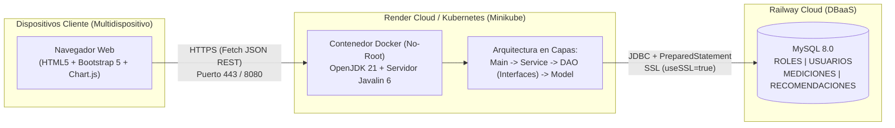
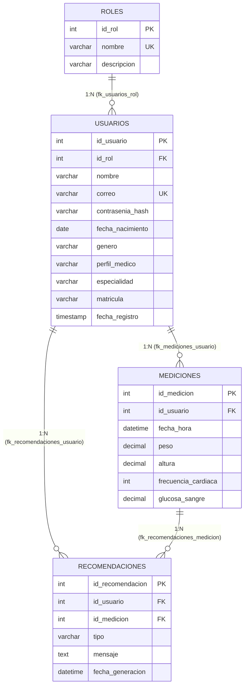
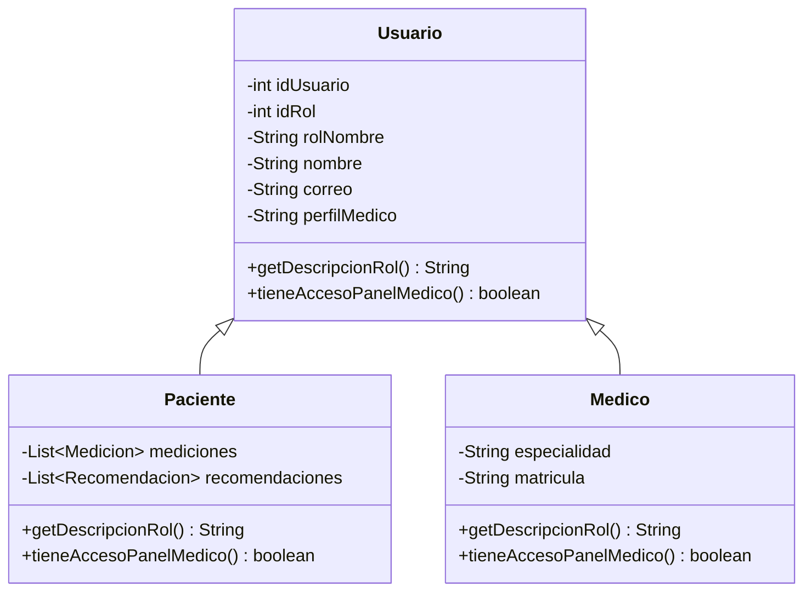

<!-- Docs/diagramas/arquitectura.md -->
# Diagramas de Arquitectura y Modelo de Datos — TuSalud

## 1. Arquitectura de Despliegue en Nube y Contenedores

---

## 2. Diagrama Entidad-Relación (Cumple R1: 4 Tablas con PK y FK)

---

## 3. Jerarquía de Herencia y Polimorfismo (Cumple R4 y R5)

