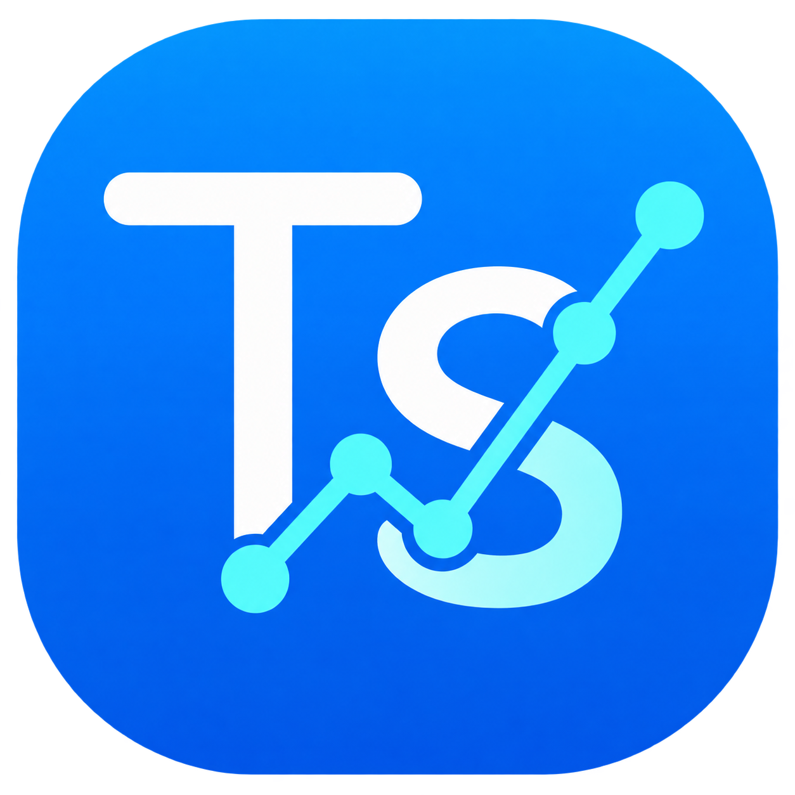
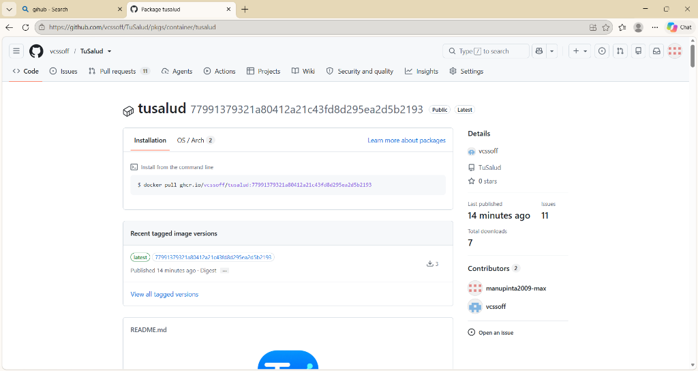
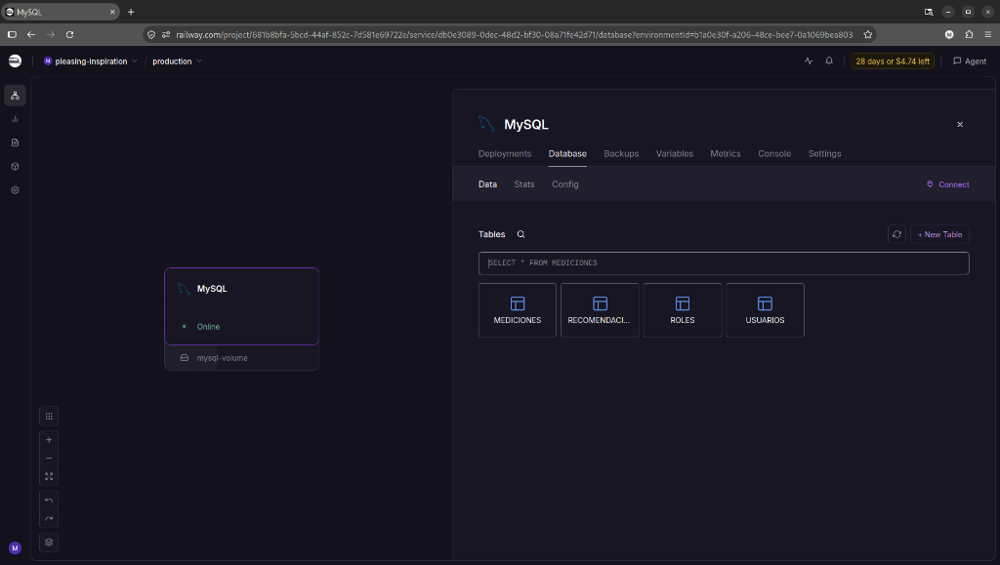
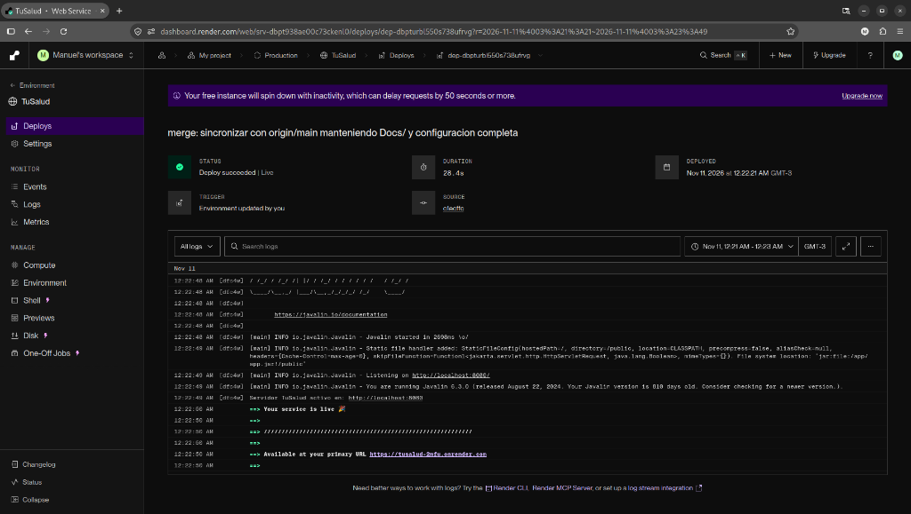
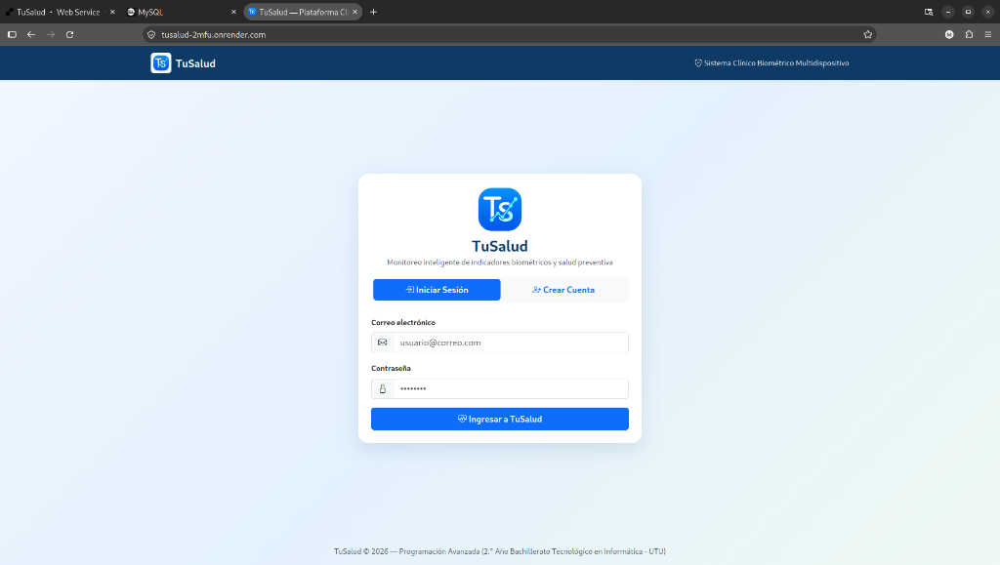
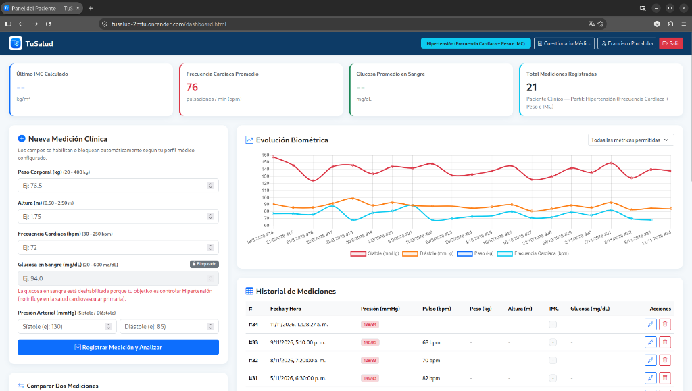
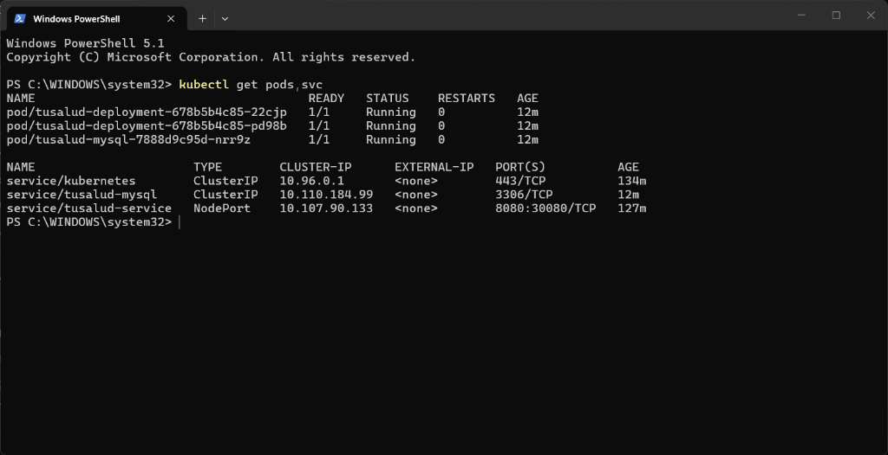

<!-- Docs/guia-despliegue.md -->
# Guía de Despliegue Reproducible — TuSalud Web

<div align="center">
  
</div>

Este documento detalla paso a paso el proceso de configuración, empaquetado, publicación y despliegue de **TuSalud** en los tres niveles exigidos en el examen:
1. **Nivel 1:** Contenedorización con Docker y publicación en GitHub Container Registry (**GHCR**).
2. **Nivel 2:** Base de datos MySQL en **Railway** y despliegue web público con HTTPS en **Render**.
3. **Nivel 3:** Orquestación local en **Kubernetes (Minikube)** mediante manifiestos declarativos (`k8s/`).

---

## 1. Requisitos Previos

* **Java JDK 21** y **Apache Maven 3.9+**
* **Git** y cuenta en **GitHub**
* **Docker Engine** y **Docker Compose**
* **Minikube** y **kubectl** (para orquestación local en talleres de clase)
* Cuenta en **Railway.app** (MySQL 8.0) y **Render.com** (Web Service)

---

## 2. Configuración de Base de Datos MySQL en la Nube (Railway)

1. Ingresar a [https://railway.app](https://railway.app) y crear un nuevo servicio **Deploy MySQL**.
2. En la pestaña **Variables** / **Connect** de Railway, copiar los valores de conexión pública:
   * `MYSQLHOST` -> `DB_HOST` (ej. `sakura.proxy.rlwy.net`)
   * `MYSQLPORT` -> `DB_PORT` (ej. `19832`)
   * `MYSQLDATABASE` -> `DB_NAME` (`railway`)
   * `MYSQLUSER` -> `DB_USER` (`root`)
   * `MYSQLPASSWORD` -> `DB_PASSWORD`
3. Crear el archivo `.env` en la raíz del proyecto a partir de `.env.example`:
   ```bash
   cp .env.example .env
   ```
4. Al iniciar la aplicación (o ejecutando manualmente los scripts de `sql/`), se crean las 4 tablas (`ROLES`, `USUARIOS`, `MEDICIONES`, `RECOMENDACIONES`):
   ```bash
   mysql -h $DB_HOST -P $DB_PORT -u $DB_USER -p$DB_PASSWORD --ssl-mode=REQUIRED railway < sql/01-crear-tablas.sql
   mysql -h $DB_HOST -P $DB_PORT -u $DB_USER -p$DB_PASSWORD --ssl-mode=REQUIRED railway < sql/02-datos-prueba.sql
   ```

---

## 3. Nivel 1: Construcción de Imagen Docker y Publicación en GHCR

### 3.1 Compilación y Construcción Local
```bash
# 1. Ejecutar pruebas unitarias y empaquetar el Fat JAR con Maven
mvn clean package

# 2. Construir la imagen Docker multi-stage
docker build -t ghcr.io/vcssoff/tusalud:latest .

# 3. Probar el contenedor localmente conectado a Railway
docker run --rm -d --name tusalud-test -p 8080:8080 --env-file .env ghcr.io/vcssoff/tusalud:latest

# 4. Verificar el endpoint de salud (R12)
curl -i http://localhost:8080/health
```

### 3.2 Publicación en GitHub Container Registry (GHCR)
```bash
# 1. Autenticarse en GHCR con un Personal Access Token (permiso write:packages)
echo $CR_PAT | docker login ghcr.io -u vcssoff --password-stdin

# 2. Etiquetar y subir la imagen al registro oficial de GitHub
docker tag ghcr.io/vcssoff/tusalud:latest ghcr.io/vcssoff/tusalud:1.0.0
docker push ghcr.io/vcssoff/tusalud:latest
docker push ghcr.io/vcssoff/tusalud:1.0.0
```

---

## 4. Nivel 2: Despliegue en la Nube con Render (HTTPS Activo)

1. Ingresar a [https://dashboard.render.com](https://dashboard.render.com) y seleccionar **New + -> Web Service**.
2. Conectar el repositorio de GitHub `vcssoff/TuSalud`.
3. Configurar el servicio:
   * **Name:** `tusalud`
   * **Runtime / Environment:** `Docker` (Render detecta automáticamente el `Dockerfile` en la raíz)
   * **Plan:** `Free`
   * **Health Check Path:** `/health`
4. En la sección **Environment Variables** de Render, cargar las variables de entorno:
   * `PORT` = `8080`
   * `DB_HOST` = *(Host de Railway)*
   * `DB_PORT` = *(Puerto de Railway)*
   * `DB_NAME` = `railway`
   * `DB_USER` = `root`
   * `DB_PASSWORD` = *(Contraseña de Railway)*
   * `DB_SSL` = `true`
5. Hacer clic en **Create Web Service**. Render compilará la imagen Docker y publicará la aplicación con certificado TLS/HTTPS automático en `https://tusalud.onrender.com`.

---

## 5. Nivel 3: Orquestación en Kubernetes Local (Minikube)

1. Iniciar el clúster local de Minikube:
   ```bash
   minikube start --driver=docker
   ```
2. Crear el archivo `k8s/secret.yaml` a partir de la plantilla `k8s/secret.yaml.example` con la contraseña real de Railway:
   ```bash
   cp k8s/secret.yaml.example k8s/secret.yaml
   ```
3. Aplicar los manifiestos de Kubernetes (`ConfigMap`, `Secret`, `Deployment` y `Service`):
   ```bash
   kubectl apply -f k8s/configmap.yaml
   kubectl apply -f k8s/secret.yaml
   kubectl apply -f k8s/app-deployment.yaml
   kubectl apply -f k8s/app-service.yaml
   ```
4. Verificar el estado de los Pods y del servicio:
   ```bash
   kubectl get pods -l app=tusalud
   kubectl get svc tusalud-service
   ```
5. Abrir la aplicación desplegada en Minikube:
   ```bash
   minikube service tusalud-service --url
   ```

---

## 6. Evidencias Visuales del Despliegue (5 Capturas Obligatorias del Examen)

> [!IMPORTANT]
> Reemplazar cada bloque a continuación por la captura de pantalla real correspondiente antes de la entrega final.

### Captura 1: Imagen publicada en GitHub Container Registry (GHCR)
*Muestra el paquete `ghcr.io/vcssoff/tusalud:latest` publicado en la sección **Packages** del repositorio de GitHub.*



---

### Captura 2: Tablas creadas y pobladas en Railway (MySQL 8.0)
*Muestra el panel **Data** de Railway con las 4 tablas (`ROLES`, `USUARIOS`, `MEDICIONES`, `RECOMENDACIONES`) y los datos reales registrados.*



---

### Captura 3: Servicio activo en Render (Live) y URL Pública
*Muestra el panel de Render con el servicio `tusalud` en estado `Live`, el log de inicio de Javalin en el puerto 8080 y la URL pública asignada `https://tusalud-2mfu.onrender.com`.*



---

### Captura 4: Aplicación Web en Producción (Login y Dashboard de Paciente con Chart.js)
*Muestra el acceso a la plataforma pública en la nube y el panel clínico interactivo con las 21 mediciones biométricas de hipertensión de Francisco Pintaluba, la gráfica evolutiva con Chart.js y la restricción por perfil médico.*





---

### Captura 5: Pods en estado `Running` en Kubernetes (Minikube)
*Muestra la terminal ejecutando `kubectl get pods` y `kubectl get svc` con las réplicas de `tusalud-deployment` en estado `Running` (1/1).*


