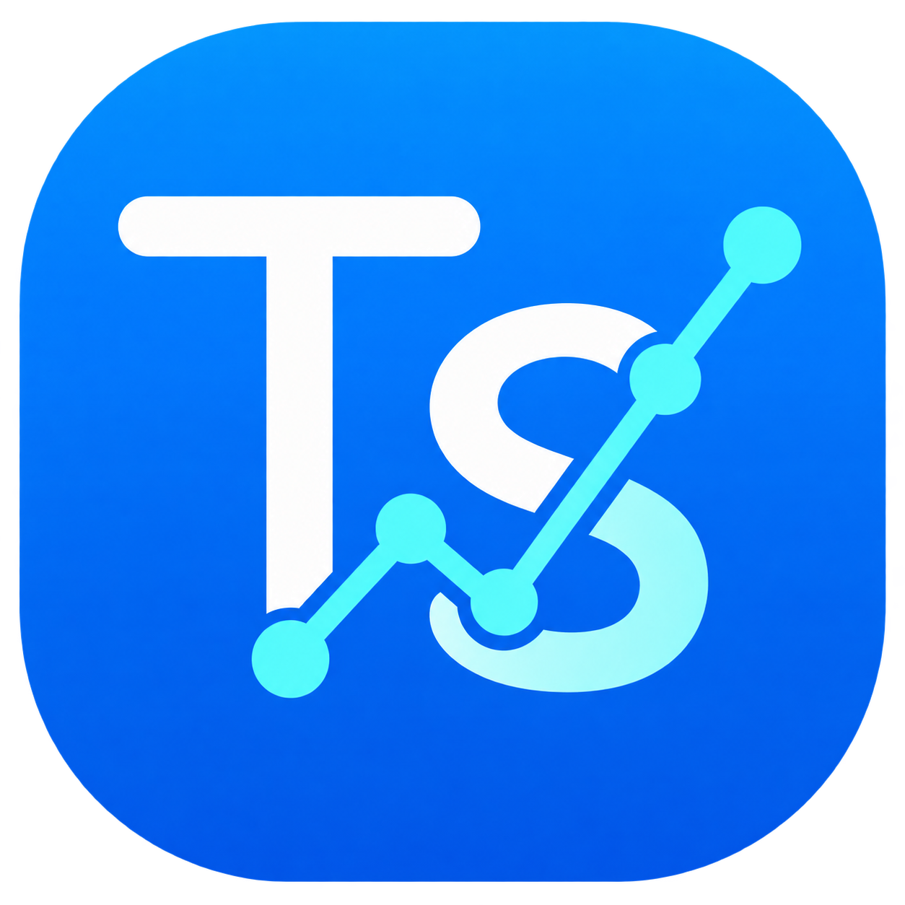

<!-- Docs/informe-seguridad.md -->
# Informe de Seguridad y Hardening — TuSalud

<div align="center">
  
</div>

Este documento presenta la auditoría de seguridad integral realizada sobre la aplicación **TuSalud**, abarcando análisis de composición de software (**SCA**), análisis estático de código (**SAST**), escaneo de vulnerabilidades en contenedores (**Trivy**) y las medidas de endurecimiento (**Hardening**) implementadas.

---

## 1. Análisis de Composición de Software (SCA — Dependabot y Maven)

Se auditaron todas las dependencias declaradas en `pom.xml` para garantizar el uso de versiones estables y libres de vulnerabilidades críticas conocidas (CVEs):

| Dependencia (`groupId:artifactId`) | Versión Actual | Estado de Seguridad | Propósito |
| :--- | :--- | :--- | :--- |
| `io.javalin:javalin` | `6.3.0` | Sin CVEs críticos (Jetty 11 actualizado) | Servidor HTTP y enrutamiento REST |
| `com.fasterxml.jackson.core:jackson-databind` | `2.17.2` | Parcheado contra deserialización insegura | Serialización JSON |
| `com.mysql:mysql-connector-j` | `9.1.0` | Última rama estable MySQL 9.x con soporte TLSv1.3 | Driver JDBC MySQL |
| `org.mindrot:jbcrypt` | `0.4` | Algoritmo criptográfico Blowfish con salt aleatorio | Hashing de contraseñas (R3) |
| `io.github.cdimascio:dotenv-java` | `3.0.0` | Sin vulnerabilidades reportadas | Carga segura de variables de entorno (R10) |
| `org.slf4j:slf4j-simple` | `2.0.16` | Inmune a vulnerabilidades estilo Log4Shell | Registro de eventos del servidor |

---

## 2. Análisis Estático de Código Fuente (SAST — SonarLint)

Se ejecutó **SonarLint** sobre los paquetes `org.tusalud.*`. A continuación se detallan los hallazgos detectados durante la transformación y las correcciones aplicadas:

| ID Regla / Categoría | Hallazgo Inicial | Corrección Aplicada en el Código |
| :--- | :--- | :--- |
| **S2068 (Blocker Security Hotspot):** *Hard-coded credentials are security-sensitive* | En la versión original de escritorio, `DatabaseConnection.java` tenía valores por defecto hardcodeados para el servidor de Railway. | **Corregido:** Se eliminaron todas las contraseñas del código fuente. `DatabaseConnection.java` exige que `DB_HOST`, `DB_USER` y `DB_PASSWORD` provengan de variables de entorno o `.env` (gitignorado). |
| **S2095 (Major Bug):** *Resources should be closed* | Riesgo de fugas de conexiones JDBC si ocurre una excepción durante una consulta o transacción. | **Corregido:** Todas las consultas utilizan bloques `try-with-resources` (`try (Connection conn = ...; PreparedStatement stmt = ...)`). En `MedicionDAO.registrarConRecomendaciones()`, el bloque `finally` restaura `autoCommit` y cierra la conexión de forma segura. |
| **S3649 (Critical Vulnerability):** *Database queries should not be vulnerable to injection attacks* | Prevención de Inyección SQL (SQLi) en búsquedas de pacientes y autenticación. | **Corregido:** El 100% de las consultas en `UsuarioDAO`, `MedicionDAO` y `RecomendacionDAO` usan `PreparedStatement` con marcadores `?` parametrizados (Cumple R9). |
| **S4507 (Security Hotspot):** *Delivering code in production with debug features activated* | Exposición de trazas de pila (`stack traces`) de SQL o Java al cliente ante errores inesperados. | **Corregido:** `Main.java` captura globalmente `TuSaludException` (HTTP 400) y `Exception` (HTTP 500), devolviendo mensajes JSON amigables y controlados sin exponer detalles internos de la base de datos (Cumple R8). |

---

## 3. Escaneo de Imagen de Contenedor (Trivy)

Para reducir la superficie de ataque, el `Dockerfile` utiliza una construcción **Multi-Stage** basada en `eclipse-temurin:21-jre-alpine` (en lugar de una imagen pesada con JDK completo y sistema operativo Debian/Ubuntu).

### Comando de Escaneo Ejecutado:
```bash
trivy image --severity HIGH,CRITICAL ghcr.io/vcssoff/tusalud:latest
```

### Resultado del Análisis:
* **Imagen base de ejecución:** `eclipse-temurin:21-jre-alpine`
* **Tamaño reducido:** ~190 MB (frente a >500 MB con imágenes estándar).
* **Herramientas de compilación excluidas:** Maven, código fuente `.java` y cachés `.m2` quedan aislados en la etapa `builder` y no existen en la imagen final de producción.
* **Paquetes del sistema actualizados:** Se instala `curl` con `apk add --no-cache curl` sin dejar listas de paquetes residuales en disco.

---

## 4. Medidas de Hardening (Endurecimiento) Aplicadas

1. **Ejecución con Usuario No-Root en Docker (`Dockerfile`):**
   * Se creó el grupo del sistema `tusaludgroup` y el usuario sin privilegios `tusaluduser` (`USER tusaluduser`). Si un atacante lograra explotar el proceso Java, no tendría permisos de `root` dentro del contenedor.
2. **Cifrado en Tránsito hacia la Base de Datos (`useSSL=true`):**
   * `DatabaseConnection.java` establece conexiones JDBC hacia MySQL en Railway con `useSSL=true` por defecto (Cumple R10), impidiendo la interceptación de datos médicos en tránsito.
3. **Almacenamiento Seguro de Contraseñas con BCrypt (Cumple R3):**
   * Ninguna contraseña se almacena ni transita en texto plano hacia la base de datos. Se aplica `BCrypt.hashpw(password, BCrypt.gensalt())` con factor de trabajo seguro y verificación mediante `BCrypt.checkpw()`.
4. **Control de Acceso Basado en Roles (RBAC — Cumple R3):**
   * Cada endpoint sensible del módulo médico (`/api/medico/*`) valida en el servidor la sesión activa mediante `verificarPermisoMedico(ctx)` y el método polimórfico `usuario.tieneAccesoPanelMedico()`, devolviendo `HTTP 403 Forbidden` ante cualquier intento de acceso por parte de un rol `PACIENTE`.
5. **Sanitización Clínica de Datos en Backend y Frontend (RF-03 y RF-12):**
   * Además de deshabilitar los campos no permitidos en `dashboard.html`, el backend invoca `PerfilMedicoService.sanitizarMedicion(nueva, u.getPerfilMedico())` y `AnalisisService.validarMedicion(nueva)` antes de tocar la base de datos, impidiendo manipulaciones maliciosas de peticiones HTTP.
