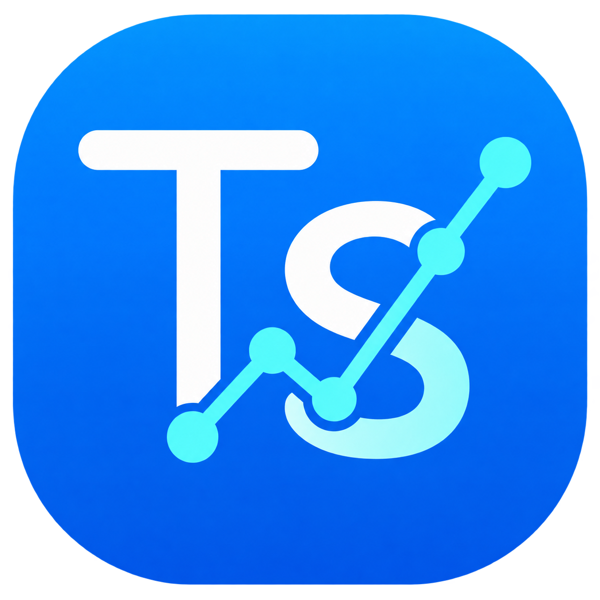

<p align="center">
  
</p>

<h1 align="center">TuSalud</h1>

<p align="center">
  <strong>Sistema Integral de Monitoreo Clínico y Biométrico</strong><br>
  <em>Bachillerato Tecnológico en Informática — 2.º Año | Programación Avanzada (UTU)</em><br>
  <strong>Docente:</strong> Matías Alfaro
</p>

<p align="center">
  <strong>Integrantes:</strong> Manuel Pintaluba, Sofía Cedrés, Rodrigo Alonso y Fabián Guillermo
</p>

<p align="center">
  
  
  
  
  
</p>

---

## 📌 Descripción del Proyecto
**TuSalud** es una solución clínica web multiplataforma diseñada para el registro, seguimiento y análisis de variables biométricas (peso, altura, frecuencia cardíaca y glucosa en sangre). El sistema clasifica el perfil médico de los pacientes (Diabetes, Hipertensión, Preventivo dual o Bienestar general), genera recomendaciones preventivas automáticas y ofrece paneles estadísticos y gráficos de evolución temporal.

---

## 📋 Matriz de Cumplimiento de Requisitos (R1 a R12)

Esta tabla sirve como evidencia directa para la defensa oral y evaluación del docente:

| ID | Requisito | Detalle / Implementación | Ubicación en el Código |
|:---|:---|:---|:---|
| **R1** | Modelo de datos | 4 entidades persistidas (`ROLES`, `USUARIOS`, `MEDICIONES`, `RECOMENDACIONES`) con PK, FK y relaciones 1:N. | [`sql/01-crear-tablas.sql`](file:///home/manuel/TuSalud/sql/01-crear-tablas.sql) |
| **R2** | CRUD completo | Alta, baja, modificación y consulta en Mediciones, Usuarios y Recomendaciones. | `org.tusalud.repository.*` |
| **R3** | Usuarios y roles | Inicio de sesión, contraseñas hasheadas con BCrypt y 2 roles: `PACIENTE` y `MEDICO`/`ADMIN`. | `UsuarioDAO.java` / `Main.java` |
| **R4** | Arquitectura en capas | Modelo, DAO, Servicio y Presentación desacoplados mediante interfaces. | `org.tusalud.repository.I*` |
| **R5** | Orientación a objetos | Jerarquía de herencia (`Usuario` base -> `Paciente`, `Medico`) y polimorfismo. | `org.tusalud.model.*` |
| **R6** | Consultas avanzadas | Búsqueda con filtros, consulta con `JOIN` y reporte estadístico con `COUNT`/`AVG` y `GROUP BY`. | `MedicionDAO.java` |
| **R7** | Transacción | Operación multi-tabla con `commit` y `rollback` (`setAutoCommit(false)`). | `UsuarioDAO.java` / `MedicionDAO.java` |
| **R8** | Validaciones y errores | Excepción propia `TuSaludException`, validación de entradas y mensajes amigables al usuario. | `TuSaludException.java` |
| **R9** | Consultas seguras | Uso estricto de `PreparedStatement` en el 100% de consultas SQL. | `org.tusalud.repository.*` |
| **R10**| Configuración externa | Credenciales leídas de variables de entorno (`.env`) sin contraseñas en el código y SSL activado. | `DatabaseConnection.java` |
| **R11**| Datos de prueba | Script de creación y carga de registros clínicos reales de prueba. | `sql/01-crear-tablas.sql` y `02-datos-prueba.sql` |
| **R12**| Estado del servicio | Endpoint `GET /health` que verifica conexión a base de datos y responde HTTP 200. | `Main.java` (`/health`) |

---

## 🚀 Despliegue y Ejecución

### Ejecución Local con Docker Compose
```bash
# 1. Copiar plantilla de variables
cp .env.example .env

# 2. Levantar aplicación y base de datos MySQL local
docker compose up --build
```
Acceder a la aplicación web en: `http://localhost:8080`

### Despliegue en la Nube
* **Base de Datos:** MySQL gestionada en Railway con conexión SSL.
* **Aplicación Web:** Desplegada en Render mediante contenedor Docker accesible vía HTTPS.
