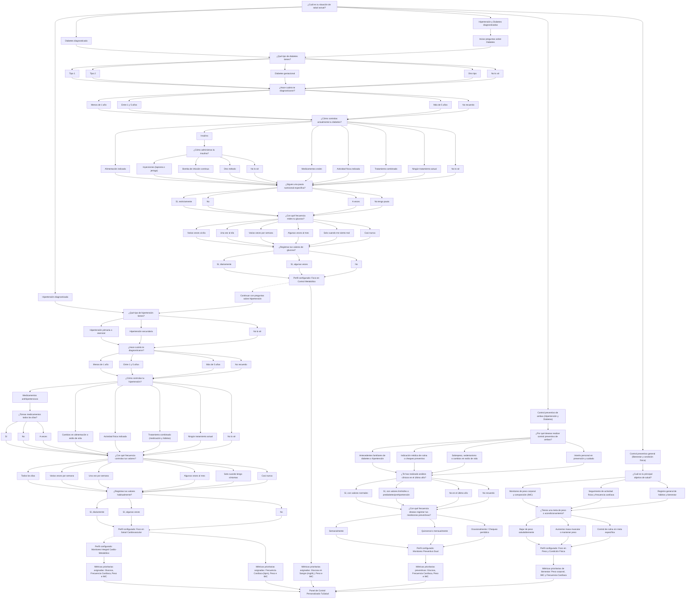

<!-- README.md -->
<div align="center">
  
  <h1>TuSalud — Sistema Clínico Web de Monitoreo Biométrico</h1>
  <p><strong>Examen Final de Programación Avanzada — 2.° Año Bachillerato Tecnológico en Informática (UTU)</strong><br>
  <strong>Docente:</strong> Matías Alfaro</p>
  <p><strong>Integrantes:</strong> Manuel Pintaluba, Sofía Cedrés, Rodrigo Alonso y Fabián Guillermo</p>
  <p>
    
    
    
    
    
  </p>
</div>

---

## 1. Descripción del Proyecto y Planteo del Problema

### El Problema
El problema que busca resolver **TuSalud** es la dificultad recurrente para registrar, organizar y analizar longitudinalmente datos biométricos personales de forma centralizada y segura. Las personas que necesitan llevar un seguimiento clínico periódico suelen registrar sus mediciones en diferentes medios dispersos (anotaciones manuscritas, planillas de cálculo genéricas o aplicaciones desconectadas que no se ajustan a su patología particular).

Esto genera serias trabajas al momento de consultar el historial clínico, comparar registros entre distintas fechas, detectar tendencias anómalas y visualizar la evolución de la salud de manera clara y comprensible.

### La Solución
**TuSalud** es una plataforma web clínica responsiva y multidispositivo diseñada para registrar, validar y analizar variables biométricas clave (**peso corporal, altura/IMC, frecuencia cardíaca y glucosa en sangre**) y emitir recomendaciones preventivas automatizadas o prescritas por profesionales de la salud.

La aplicación permite a los usuarios:
* Centralizar y asegurar sus datos de salud con control estricto de privacidad por usuario y por rol (`PACIENTE` y `MEDICO`/`ADMIN`).
* Personalizar su seguimiento mediante un cuestionario clínico inicial que restringe y adapta la captura a sus necesidades (Hipertensión, Diabetes, Preventivo Dual o Bienestar General).
* Analizar automáticamente promedios, estadísticas y gráficos temporales interactivos de evolución.
* Comparar mediciones entre dos momentos temporales para evaluar el impacto de tratamientos y hábitos.
* Proporcionar a los médicos un panel clínico centralizado para auditar historias clínicas completas y prescribir recomendaciones directas.

La solución conserva el **100% de su lógica clínica en capas Java 21** (`model`, `repository`, `service`, `config`, `exception`) y expone su presentación a través de un servidor web embebido **Javalin 6.x** con vistas **HTML5 + Bootstrap 5 + Chart.js**, conectado con **SSL (`useSSL=true`)** a **MySQL 8.0 en Railway** y empaquetado en contenedores inmutables **Docker**.

---

## 2. Alcance del Sistema

### Funcionalidades contempladas:
* **Autenticación y Roles:** Registro seguro e inicio de sesión con hashing criptográfico jBCrypt, distinguiendo perfiles de paciente y médico/administrador.
* **Cuestionario Clínico de Bienvenida (Onboarding):** Clasificación del perfil de salud del usuario para determinar qué variables biométricas registrar y editar.
* **Gestión de Mediciones (CRUD):** Registro con fecha y hora, consulta histórica ordenada, modificación y eliminación con reglas biológicas y aislamiento por usuario.
* **Cálculo Estadístico y Promedios:** Estimación de medias aritméticas para frecuencia cardíaca, glucosa e Índice de Masa Corporal (IMC).
* **Visualización Gráfica Interactiva:** Gráficos cronológicos mediante Chart.js que permiten alternar y visualizar las distintas métricas a lo largo del tiempo.
* **Comparador Biométrico:** Herramienta para contrastar dos mediciones en fechas distintas, calculando diferenciales exactos de peso, IMC, pulso y glucemia.
* **Motor de Recomendaciones:** Generación automatizada de alertas preventivas contextuales basadas en umbrales de salud, sumado a la prescripción médica personalizada.
* **Panel Clínico Profesional:** Vista médica para consultar historias clínicas consolidadas de pacientes y reportes globales agregados (`GROUP BY`).

> [!IMPORTANT]
> **Aclaración de Alcance:** El proyecto no pretende realizar diagnósticos médicos definitivos ni sustituir la evaluación o criterio de profesionales de la salud. Las recomendaciones generadas automáticamente son de carácter orientativo y preventivo.

---

## 3. Cuestionario Médico Inicial (Flujo de Onboarding)

Para conocer las necesidades particulares de cada paciente y determinar automáticamente qué variables biométricas priorizar en su seguimiento, el sistema implementa el siguiente flujo condicional interactivo:



### Configuración del Perfil y Restricción de Variables Biométricas

El sistema garantiza que **cada paciente únicamente pueda registrar y modificar las variables biométricas pertinentes a su condición médica**, bloqueando automáticamente los campos no correspondientes tanto al ingresar nuevas mediciones como al editarlas en el historial:

* **Diabetes diagnosticada:** Permite registrar y modificar **Glucosa en sangre (mg/dL)** y control metabólico de **Peso corporal e IMC**. La **Frecuencia Cardíaca (bpm) queda deshabilitada** por no influir en el control metabólico directo.
* **Hipertensión diagnosticada:** Permite registrar y modificar **Frecuencia Cardíaca (bpm)** y control de sobrepeso (**Peso corporal e IMC**). La **Glucosa en sangre queda deshabilitada** por no influir en la salud cardiovascular primaria.
* **Hipertensión y Diabetes / Preventivo Dual:** Habilita el registro integral de las cuatro variables biométricas para un seguimiento clínico cruzado cardio-metabólico.
* **Control preventivo general:** Permite peso, altura y pulsaciones según el objetivo físico elegido (descenso de peso, rendimiento o bienestar), bloqueando la glucosa al tratarse de un paciente sin afección metabólica.

---

## 4. Marco Teórico y Variables Biométricas

### Datos biométricos registrados

La aplicación gestiona cuatro magnitudes clínicas estandarizadas:
* **Peso:** Peso corporal del usuario expresado en kilogramos.
* **Altura:** Estatura del usuario expresada en metros (utilizada para el cálculo del IMC).
* **Frecuencia cardíaca:** Cantidad de latidos por minuto en reposo o actividad.
* **Glucosa en sangre:** Concentración de glucosa registrada en sangre capilar o venosa.

Cada registro clínico puede contener los datos disponibles en el momento de la toma. No es obligatorio completar todos los campos simultáneamente, siempre que se ingrese al menos una variable biométrica válida según el perfil activo. El sistema almacena automáticamente la fecha y hora (`datetime`) en la que se efectúa cada medición.

### Definición y modelado de una medición

Una instancia de la clase `Medicion` representa una muestra puntual en una fecha y hora determinadas:
* Los datos registrados de forma simultánea forman un registro histórico atómico.
* Cada `Medicion` pertenece estrictamente a un `Usuario` mediante su identificador foráneo (`id_usuario`), garantizando aislamiento y privacidad.
* La edad del paciente no se almacena como dato estático redundante en la medición, sino que se calcula dinámicamente a partir del campo `fechaNacimiento` de la entidad `Usuario`.

### Unidades de los datos biométricos

| Magnitud Clínica | Unidad Estándar | Notación y Formato | Ejemplo |
| :--- | :--- | :--- | :--- |
| **Peso** | Kilogramos | `kg` (decimal) | `72.50 kg` |
| **Altura** | Metros | `m` (decimal) | `1.75 m` |
| **Frecuencia cardíaca** | Latidos por minuto | `bpm` (entero) | `72 bpm` |
| **Glucosa en sangre** | Miligramos por decilitro | `mg/dL` (decimal) | `95.00 mg/dL` |

---

## 5. Alternativas Consideradas

Durante la etapa de diseño preliminar se evaluó la alternativa de utilizar **planillas de cálculo compartidas** (por ejemplo, Google Sheets o Excel) para el registro manual de mediciones por parte de cada usuario.

Si bien esta alternativa ofrecía un almacenamiento tabular inicial rápido y fórmulas básicas:
* Carecía de un esquema formal de autenticación, roles de acceso y cifrado seguro de contraseñas.
* Exigía que el paciente ingresara y formateara manualmente la información sin validaciones de rango biológico en tiempo real.
* No brindaba una interfaz interactiva adaptada a perfiles patológicos específicos ni bloqueos contextuales de métricas irrelevantes.
* Dificultaba la generación automática de recomendaciones clínicas, la consulta segura mediante API y la auditoría médica centralizada.

Por tales motivos se concluyó que el desarrollo de una solución de software propia en capas Java y arquitectura web representaba la alternativa idónea para garantizar escalabilidad, seguridad e integridad clínica.

---

## 6. Arquitectura y Stack Tecnológico

| Capa / Componente | Tecnología Utilizada | Propósito |
| :--- | :--- | :--- |
| **Lenguaje y Runtime** | Java 21 (OpenJDK / Eclipse Temurin 21) | Lógica orientada a objetos, herencia, polimorfismo y tipado fuerte |
| **Servidor Web y API REST** | Javalin 6.3.0 + Jackson Databind | Microservidor web embebido ligero (~80 MB RAM) y endpoints JSON |
| **Presentación Web** | HTML5 + Bootstrap 5.3 + Chart.js 4.4 | Vistas responsivas multidispositivo y gráficos estadísticos interactivos |
| **Persistencia y Datos** | MySQL 8.0 (Railway Cloud) + JDBC | Almacenamiento relacional con `PreparedStatement`, transacciones y SSL |
| **Seguridad** | jBCrypt 0.4 + `dotenv-java` 3.0.0 | Hashing de contraseñas con salt y variables de entorno externas |
| **Contenedores y Nube** | Docker Multi-Stage + Render + K8s (Minikube) | Empaquetado inmutable con usuario no-root, despliegue HTTPS y orquestación |

---

## 7. Tabla Oficial de Evidencias de Cumplimiento (R1 a R12)

Esta tabla resume la correspondencia exacta entre los requisitos solicitados para la defensa oral y su implementación en el código fuente:

| Código | Requisito del Examen | Archivo(s) de Evidencia | Clase / Método / Línea Exacta |
| :--- | :--- | :--- | :--- |
| **R1** | **Modelo de datos:** 4 entidades persistidas con PK y FK. | `sql/01-crear-tablas.sql`<br>`src/main/resources/db/schema.sql` | Tablas `ROLES`, `USUARIOS`, `MEDICIONES` y `RECOMENDACIONES` con `PRIMARY KEY` y `FOREIGN KEY` (`fk_usuarios_rol`, `fk_mediciones_usuario`, `fk_recomendaciones_usuario`, `fk_recomendaciones_medicion`). |
| **R2** | **CRUD completo:** Alta, baja, modificación y consulta en al menos 3 entidades. | `src/main/java/org/tusalud/repository/UsuarioDAO.java`<br>`src/main/java/org/tusalud/repository/MedicionDAO.java`<br>`src/main/java/org/tusalud/repository/RecomendacionDAO.java` | • **Usuarios:** `registrar()`, `obtenerPorId()`, `actualizarDatosUsuario()`, `eliminar()`<br>• **Mediciones:** `agregar()`, `obtenerPorUsuario()`, `actualizar()`, `eliminar()`<br>• **Recomendaciones:** `guardar()`, `obtenerPorUsuario()`, `actualizar()`, `eliminar()` |
| **R3** | **Usuarios y roles:** Login, hash BCrypt y al menos 2 roles con permisos distintos. | `src/main/java/org/tusalud/repository/UsuarioDAO.java`<br>`src/main/java/org/tusalud/Main.java`<br>`src/main/resources/public/medico.html` | • Hashing y verificación: `BCrypt.hashpw()` y `BCrypt.checkpw()` en `UsuarioDAO.registrar()` e `iniciarSesion()`.<br>• Control de acceso por rol (`PACIENTE` vs `MEDICO`/`ADMIN`): `Main.verificarPermisoMedico(ctx)` y `Usuario.tieneAccesoPanelMedico()`. |
| **R4** | **Arquitectura en capas:** Modelo, DAO, Servicio y Presentación con interfaces. | `src/main/java/org/tusalud/repository/IUsuarioDAO.java`<br>`src/main/java/org/tusalud/repository/IMedicionDAO.java`<br>`src/main/java/org/tusalud/repository/IRecomendacionDAO.java`<br>`src/main/java/org/tusalud/service/Promedio.java` | Interfaces explícitas implementadas por `UsuarioDAO`, `MedicionDAO`, `RecomendacionDAO` y `AnalisisService`, desacopladas del controlador web `Main.java`. |
| **R5** | **Orientación a objetos:** Herencia en el dominio y polimorfismo. | `src/main/java/org/tusalud/model/Usuario.java`<br>`src/main/java/org/tusalud/model/Paciente.java`<br>`src/main/java/org/tusalud/model/Medico.java` | `Paciente extends Usuario` y `Medico extends Usuario` sobrescriben polimórficamente `getDescripcionRol()` y `tieneAccesoPanelMedico()`. Instanciación polimórfica en `UsuarioDAO.mapearUsuarioPolimorfico()`. |
| **R6** | **Consultas avanzadas:** Consulta con `JOIN` y reporte con `COUNT`/`AVG` y `GROUP BY`. | `src/main/java/org/tusalud/repository/UsuarioDAO.java`<br>`src/main/java/org/tusalud/repository/MedicionDAO.java` | • **Consulta JOIN (4 tablas):** `UsuarioDAO.obtenerHistoriaClinicaConsolidada(int idUsuario)`<br>• **Reporte GROUP BY Perfil:** `UsuarioDAO.obtenerReporteGlobalPorPerfil()` (`COUNT`, `AVG`, `GROUP BY`)<br>• **Reporte GROUP BY Mes:** `MedicionDAO.obtenerEvolucionMensualGlobal()` |
| **R7** | **Transacciones:** Operación sobre 2 o más tablas con `commit` y `rollback`. | `src/main/java/org/tusalud/repository/MedicionDAO.java` | Método `MedicionDAO.registrarConRecomendaciones(Medicion m, List<Recomendacion> recomendaciones)` con `conn.setAutoCommit(false)`, inserción en `MEDICIONES` + `RECOMENDACIONES`, `conn.commit()` y `conn.rollback()` en bloque `catch`. |
| **R8** | **Validaciones y errores:** Validación de entradas y excepción propia sin filtrar errores internos. | `src/main/java/org/tusalud/exception/TuSaludException.java`<br>`src/main/java/org/tusalud/service/AnalisisService.java`<br>`src/main/java/org/tusalud/Main.java` | • Excepción de dominio: `TuSaludException`<br>• Validación biológica: `AnalisisService.validarMedicion(Medicion m)`<br>• Captura global limpia HTTP 400: `app.exception(TuSaludException.class, ...)` en `Main.java`. |
| **R9** | **Consultas seguras:** `PreparedStatement` en todas las consultas. | `src/main/java/org/tusalud/repository/UsuarioDAO.java`<br>`src/main/java/org/tusalud/repository/MedicionDAO.java`<br>`src/main/java/org/tusalud/repository/RecomendacionDAO.java` | 100% de las sentencias SQL utilizan `conn.prepareStatement(sql)` con parámetros `?` tipados (`setInt`, `setDouble`, `setString`, `setDate`). |
| **R10** | **Configuración externa:** Credenciales leídas de variables de entorno / `.env` con SSL. | `src/main/java/org/tusalud/config/DatabaseConnection.java`<br>`.env.example` | Método `DatabaseConnection.getEnv()` leyendo `DB_HOST`, `DB_PORT`, `DB_NAME`, `DB_USER`, `DB_PASSWORD` y `DB_SSL` (`useSSL=true`), sin credenciales en el código fuente. |
| **R11** | **Datos de prueba:** Scripts SQL de creación y datos reales. | `sql/01-crear-tablas.sql`<br>`sql/02-datos-prueba.sql` | Script DDL de creación de las 4 tablas y script de inserción de roles base y datos reales cargados desde la aplicación. |
| **R12** | **Estado del servicio:** Endpoint `/health` que responde HTTP 200. | `src/main/java/org/tusalud/Main.java` | Ruta `app.get("/health", ...)` que verifica conectividad real con MySQL (`SELECT 1`) y devuelve HTTP 200 `{"status":"UP","database":"CONNECTED"}`. |

---

## 8. Instrucciones de Compilación y Ejecución Rápida

### Opción A: Ejecución Local con Maven y JDK 21
1. **Configurar variables de entorno:**
   Copiar la plantilla `.env.example` a `.env` y configurar las credenciales de base de datos MySQL en Railway o local:
   ```bash
   cp .env.example .env
   ```
2. **Compilar y empaquetar el Fat JAR:**
   ```bash
   mvn clean package
   ```
3. **Iniciar el servidor web:**
   ```bash
   java -jar target/TuSalud-1.0-SNAPSHOT-jar-with-dependencies.jar
   ```
4. **Acceder a la aplicación:**
   - **Portal Web:** `http://localhost:8080`
   - **Healthcheck de Diagnóstico (R12):** `http://localhost:8080/health`

### Opción B: Ejecución con Docker Compose
```bash
docker compose up --build -d
```
Acceso web directo en `http://localhost:8080`.

---

## 9. Documentación Oficial Adjunta (`Docs/`)

* **[Guía de Despliegue Paso a Paso (`Docs/guia-despliegue.md`)](Docs/guia-despliegue.md):** Manual reproducible para Railway, Docker, GHCR, Render y Kubernetes (Minikube), con las secciones para las 5 capturas obligatorias.
* **[Informe de Seguridad y Hardening (`Docs/informe-seguridad.md`)](Docs/informe-seguridad.md):** Análisis de dependencias (SCA), código estático (SAST con SonarLint), escaneo de imagen con Trivy y medidas de endurecimiento aplicadas.
* **[Diagramas de Arquitectura y Base de Datos (`Docs/diagramas/arquitectura.md`)](Docs/diagramas/arquitectura.md):** Diagrama de despliegue en nube y modelo entidad-relación de las 4 tablas.
* **[Requisitos del Sistema (`Docs/Requirements.md`)](Docs/Requirements.md):** Requisitos funcionales y no funcionales del sistema.
* **[Stack Tecnológico (`Docs/Stack.md`)](Docs/Stack.md):** Especificación de herramientas, librerías y tecnologías.
* **[Diagramas UML (`Docs/UML.md`)](Docs/UML.md):** Diagrama de clases y especificación de casos de uso del sistema.
